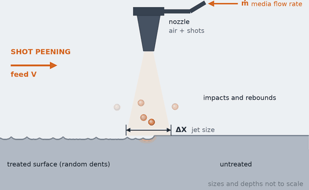

# Shot Peening Coverage Simulator

**Dr Régis Kubler**, Arts et Métiers Institute of Technology
*Developed with the assistance of Claude Opus 5.5 (Anthropic), October 2026*

Interactive educational tool showing how surface coverage builds up during
shot peening, as a function of the number of passes, media flow rate,
shot size distribution, jet size and traverse speed.

**▶ Live simulator:** https://YOUR-USERNAME.github.io/peening-coverage/

## What the simulator shows
- A jet sweeping a square part line by line at traverse speed V
- A microscope view of a small area where circular dents of radius r appear pass after pass
- Measured coverage compared with the model τ(n) = 100·(1 − e^(−K·n))
- A map of how many times each point has been hit, and its histogram compared with the Poisson law
- A log-normal shot size distribution (spread σ), with the Sauter mean diameter D₃₂

## Model
Coverage after n passes: τ(n) = 100·(1 − e^(−K·n)),
with K = 6·ṁ·c² / (ρ·D₃₂·V·ΔX), where c = r/D and D₃₂ = E[D³]/E[D²]
(random Poisson impacts, Boolean model). For identical shots, D₃₂ = D.

## Coverage above 100 % (NF L 06-832)

The base time is the peening time needed to dent 98 % of the surface. Full coverage (100 %) is 1.25 × the base time (an option sets it to the base time instead), and 200 % or 300 % means 2 or 3 times the time of full coverage. On an even random treatment, full coverage corresponds to λ = 1.25·ln 50 = 4.89 impacts per point on average (99.25 % dented); the local coverage level of a point is 100·λ/4.89.

Version 1.3 (18 November 2026): coverage level reached, passes for a specified coverage, option for the 1.25 factor.

## Documentation
- [Coverage model note (PDF)](coverage_model_note.pdf): the original spreadsheet model, step by step
- [Simulator technical note (PDF)](simulator_note.pdf): size distributions, random laws, algorithm, validation
- [Coverage model spreadsheet (Excel)](coverage_model_en.xlsx): live formulas, log-normal size spread and a sieve-analysis sheet
- LaTeX sources and figures: [`latex/`](latex/)

## Use
Open the live link above, or download `index.html` and open it in any web
browser (works offline; no installation needed).

## Limitations
Educational model with simplifying assumptions (uniform jet, random
independent impacts, dent radius proportional to shot diameter, flat surface,
normal incidence). It does not replace coverage verification according to
the applicable standards (e.g. SAE J2277).

## Author and acknowledgement
Model and parameters: Dr Régis Kubler, Arts et Métiers Institute of Technology.
The interactive simulator, the documentation and the Monte Carlo validation
were developed with the assistance of Claude Opus 5.5 (Anthropic), October 2026.
All content was reviewed by the author.

## Licence
Code (`index.html`): MIT, see [LICENSE](LICENSE).
Documentation (PDFs, LaTeX sources, figures): CC BY 4.0.

## Cite as
Kubler, R. (2026). *Shot Peening Coverage Simulator*. Arts et Métiers Institute of Technology. Zenodo. DOI: [to add]
